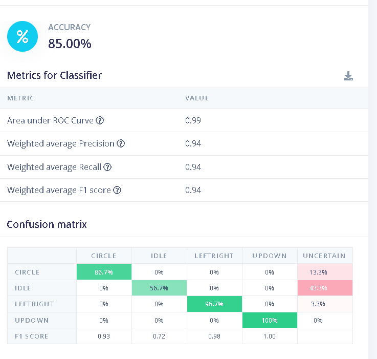
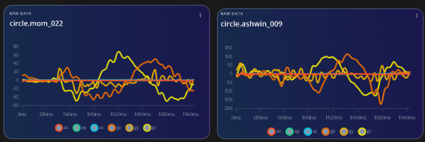

# ESP32 Gesture Recognizer (TinyML)

Wave a motion sensor, and an ESP32 recognises the gesture **on-device** with a small neural network: no cloud, no Wi-Fi.

**Gestures:** `circle` · `updown` · `leftright` · `idle` (anything that is not a gesture)

▶️ **Demo video:** https://www.youtube.com/watch?v=B2O4ColYG9E

---

## Results at a glance

| Evaluation | Data | Accuracy |
|---|---|---|
| Validation (Edge Impulse) | 20% of my own training data | 87.5% |
| **Test, unseen person** (Edge Impulse) | 25 samples/class from a family member + ~5/class of mine | **85.0%** (F1 0.94) |
| **On the ESP32, live** | 10 attempts per gesture, by me | circle 6/10 · updown 5/10 · leftright 10/10 |
| **False triggers during normal handling** | 10 idle movements (pick up, fidget, put down) | 2/10 triggered a gesture (both as `updown`) |

Most on-device misses were **"uncertain"** (below the 80% confidence threshold, so nothing fires), not wrong gestures: only 4 of 40 live attempts produced a confidently wrong label.



---

## How it works

```
MPU6050 (I2C, 100 Hz) → ESP32 → motion trigger → 2 s window (6 axes × 200 samples)
→ Spectral Analysis features → neural network (int8) → label if confidence ≥ 80%
```

1. **Sampling:** accelerometer (±2 g) and gyroscope (±250 °/s) read directly over I2C at 100 Hz, 44 Hz on-chip low-pass filter, gyro offsets calibrated at startup.
2. **Trigger:** the board waits until gyro speed exceeds 30 °/s, then classifies a 2 s window containing 0.6 s before the trigger and 1.4 s after.
3. **Model:** Edge Impulse Spectral Analysis + dense classifier, quantized to int8, exported as an Arduino library.
4. **Decision:** a prediction is accepted only if confidence ≥ 80%. Otherwise the output is "uncertain" and nothing happens. An 800 ms cooldown stops the return-to-rest movement from being classified.

## Hardware

| Part | Notes |
|---|---|
| ESP32 dev board | Arduino core, `ESP32 Dev Module` |
| GY-521 (MPU6050) | Header pins hand-soldered |
| Breadboard + jumpers | An arrow drawn on the board fixes the grip orientation |

| GY-521 | ESP32 |
|---|---|
| VCC | 3V3 (**not** 5V/VIN) |
| GND | GND |
| SCL | GPIO22 |
| SDA | GPIO21 |

## Dataset

- **Training: me only** (`data/ashwin/`). Started at ~25 samples/class, then added targeted samples after testing (see below): varied circles, pick-up/put-down idles, and slow up-down swipes.
- **Test: a second person** (`data/mom/`, 25 samples/class), **never used for training**, plus ~5/class of my own from the automatic split.
- Fixed grip: board flat in the right hand, chip up, arrow pointing away from the user.
- Each sample is 2 s at 100 Hz, 6 channels (ax, ay, az in g; gx, gy, gz in °/s).

## Reproduce

1. Flash `firmware/mpu_raw`, then record: `python tools/capture.py <label> <name>`
2. Upload the CSVs to Edge Impulse (Data acquisition → Upload). Training data: *Training*; second person: *Testing*.
3. Impulse: 2000 ms window, 500 ms increase, 100 Hz → Spectral Analysis (all 6 axes) → Classification (100 cycles).
4. Deploy as an **Arduino library (int8)**, install the ZIP, and flash `firmware/gesture_inference`.

---

## What failed and why

**1. Circles collapsed on a new person (20% accuracy).**
The first model scored 87.5% on validation but only 64% on the second person's data. Circle was the worst class: 70% of their circles came out "uncertain."
Comparing raw gyro plots showed why. Same shape, same direction, but **their circles were 2–3× slower and gentler** (peaks around ±60 °/s vs. my ±150 °/s).



*Fix:* recorded more of **my own** circles with deliberate variety (slow, big, tilted). Circle went from 20% to **86.7%**, without adding any of their data to training.

**2. Fixing idle broke up-down (90% → 13%).**
Picking up the board was being classified as an up-down swipe, so I added pick-up/put-down samples to idle. That taught the model that slow vertical motion means idle, and the second person's slow up-downs fell into "uncertain."
*Fix:* added slow, gentle up-down samples. Up-down went back to **100%**.

**Remaining weakness: idle ↔ up-down.** On the board, 2 of 10 idle movements (picking the board up) fired as `updown`. Lifting the board is a vertical motion, which looks like half an up-down swipe. A fix would need more pick-up samples *and* more slow up-downs together, so the model learns the difference rather than trading one class for the other.

**3. Live accuracy is lower than Edge Impulse accuracy.**
In Edge Impulse, test windows are cut the same way as the training windows. On the board, the motion trigger decides where the window starts. With 0.3 s of pre-trigger buffer, up-down was mostly uncertain. Increasing it to 0.6 s, closer to the training data's typical start, improved it, but circle and up-down are still less robust than left-right.

**4. Tooling.** The Edge Impulse data forwarder failed to authenticate on Node.js 26, so I wrote `tools/capture.py` to record labelled CSVs and uploaded them manually.

### Honest caveats
- One person trained the model and one person tested it. That says little about the general population.
- I looked at the test results twice and collected more training data in response, so the test set is no longer perfectly "unseen."
- The grip is fixed. Holding the board differently will shift gravity across the axes and break the model.

## Next steps
- Collect training data from several people.
- Compare hand-crafted features against a 1D CNN on the same split.
- Train with randomly shifted windows so the model doesn't depend on where the gesture starts.
- Log the "best" label for uncertain predictions to see whether a lower confidence threshold (e.g. 70%) would turn them into correct answers without adding false triggers.
- Use gestures to control something (LEDs, slides over BLE).

## Tools
ESP32 Arduino core · Edge Impulse · Python (pyserial) · MPU6050

## License
MIT